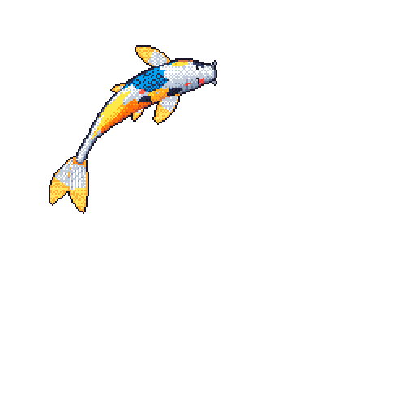
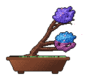

<picture>
  
</picture>

<picture>
  
</picture>
<picture>
  
</picture>

 
<a href="https://github.com/yalongwastaken#year-list-container">
  <picture>
    <source media="(prefers-color-scheme: dark)" srcset="cards/stats-dark.svg">
    
  </picture>
</a>
<a href="https://github.com/yalongwastaken?tab=repositories">
  <picture>
    <source media="(prefers-color-scheme: dark)" srcset="cards/languages-dark.svg">
    
  </picture>
</a>
 
